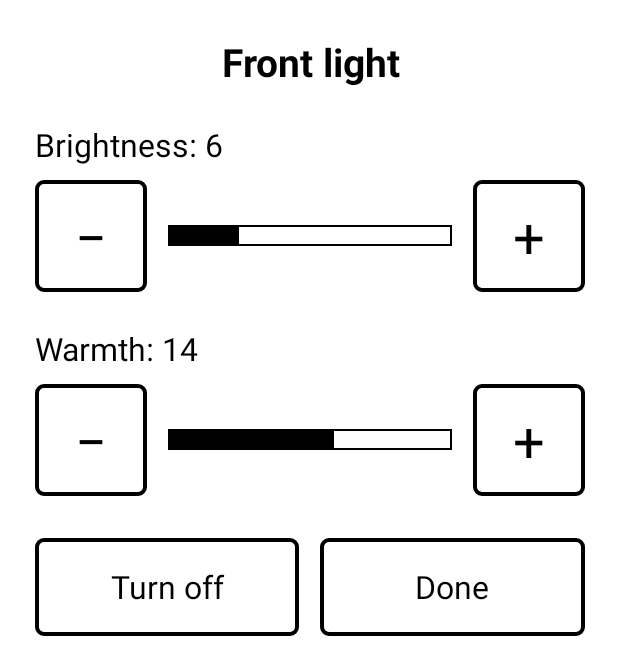
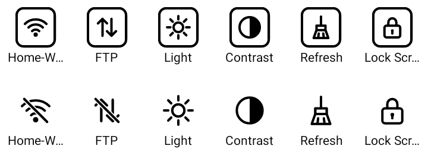

# E-Ink Launcher

A home screen for Android e-readers, drawn in pure black and white for e-ink: no gray
backdrops, no animations, big touch targets, and as little RAM as possible while you read.

<p>
  
  
  
</p>

## Features

- **Continue reading with KOReader**: a card above the apps shows the book last opened in
  [KOReader](https://koreader.rocks/) (cover, title, author and progress) and reopens it with
  one tap. It reads KOReader's own files; nothing to configure. Hidden when KOReader isn't
  installed.
- **App grid** with adjustable columns, rows and text size, custom sort orders and priorities,
  hidden apps, custom icons and Android shortcuts.
- **Quick bar** with Wi-Fi, the FTP server, front light, contrast, refresh and screen lock on one
  centered row. Each item can be hidden; the icons are evenly spaced and stay put when a label
  changes (the Wi-Fi network name, for example). Two icon styles: framed or line.

  

- **Bottom bar** with page, date and time, battery (icon, ring or text) and settings. If you turn
  on the system status bar, which already shows time and battery, the bottom bar goes away and
  settings move to the end of the quick bar.
- **Built-in FTP server** to copy books and APKs from a computer over Wi-Fi: switch it on from
  the quick bar, which then shows the address to connect to (long press to see it again).
- **Low memory use**: only the icons on screen are loaded, scaled to the cell, and everything is
  released while another app (your reader) is in front. The (i) button in the settings shows how
  much the launcher uses, in the foreground and in the background.
- **Languages**: English, Italian, Chinese, Polish and Korean, selectable in the launcher itself.

### Moaan / inkPalm devices

On Moaan firmwares (inkPalm 5 and rebrands such as *my mini read* EPD105) the launcher also
replaces the firmware's own panels, which are drawn off-center:

- a **front light** panel (brightness and warmth, 0–24 each) and a **contrast** panel (6 levels),
  set the same way the firmware's SystemUI does;
- one-tap lock, refresh and Wi-Fi toggles that work around the firmware's quirks.

The firmware force-stops an app 30 seconds after it leaves the screen unless the app is
*unfrozen* in its *App freeze* list. Unfreeze E-Ink Launcher there if you want its FTP server to
keep running while you read. The list is in the settings of the firmware's stock launcher, which
other launchers can't open: do it before choosing E-Ink Launcher as Home, or switch back to the
stock launcher for a moment.

The application id is `com.moan.moanwm` because the firmware only lets whitelisted packages use
some of its features (e.g. *App info*).

Tested on an inkPalm 5 (EPD105, Android 8.1). It runs on Android 4.2 and later, but the
Moaan-specific parts only appear on Moaan firmwares.

## Install

Download the APK from the [releases](../../releases), copy it to the device (for example with
the launcher's FTP server or over USB) and open it with a file manager. Press Home and choose
*E-Ink Launcher*, then *Always*.

On the inkPalm 5 developer options and adb are disabled by the firmware, so there is no other
way to install it.

## Build

Requirements: JDK 17 and the Android SDK (platform 34).

```sh
./gradlew assembleHomeDebug        # debug build, id com.moan.moanwm.dev: installs next to a release
./gradlew assembleHomeRelease      # release build, minified with R8
./gradlew testHomeDebugUnitTest    # Robolectric tests of the launcher lifecycle (API 27)
./gradlew testHomeDebugUnitTest -Pscreenshots   # also renders screens to app/build/screenshots/
```

Release builds are signed when a `keystore.properties` file exists at the project root
(it is gitignored):

```properties
storeFile=/path/to/release.jks
storePassword=...
keyAlias=...
keyPassword=...
```

Each release build keeps its R8 mapping in `app/release/mappings/`, to decode crash reports
shown on the device.

The quick bar icons are vector drawables generated from one set of symbols, so every icon has
the same stroke: after changing a symbol in `tools/GenQuickIcons.java`, run
`java tools/GenQuickIcons.java app/src/main/res/drawable`.

## History and credits

This is a fork of a fork:

- [Modificator](https://github.com/Modificator/E-Ink-Launcher) wrote the original E-Ink Launcher;
- [shunf4](https://github.com/shunf4/E-Ink-Launcher) added sorting, priorities and shortcuts;
- [qwerty12](https://github.com/qwerty12/E-Ink-Launcher) (Faheem Pervez) added the inkPalm
  support;
- this fork modernizes the build and adds the KOReader card, the quick bar, the new settings,
  the front light and contrast panels and the memory work.

Translations: Maciej Haudek (Polish), Limerainne (Korean).

## License

[Apache License 2.0](LICENSE)
